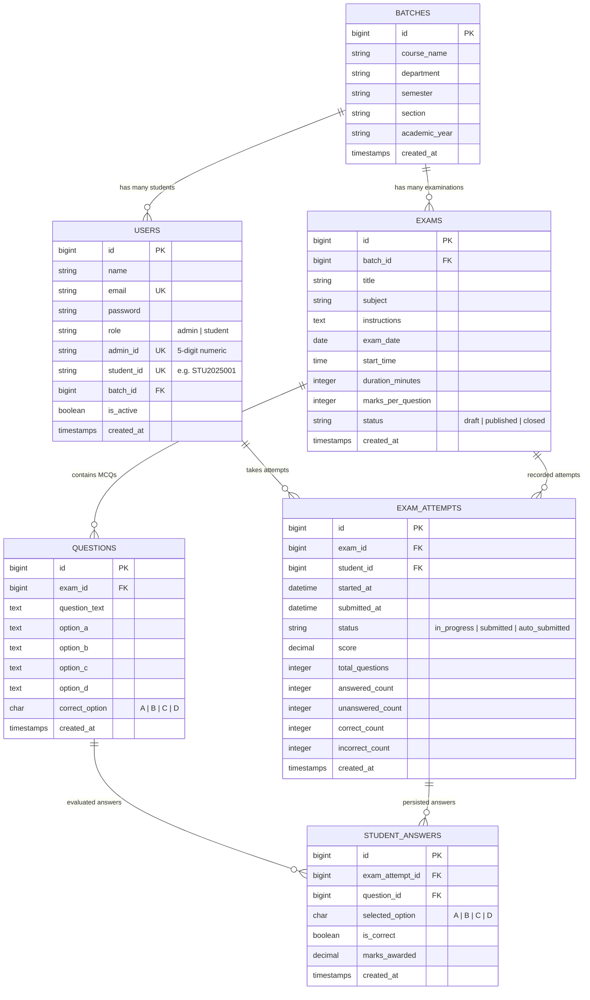

# Online Examination System

A complete, beginner-friendly academic **Online Examination System** built with **Laravel, Eloquent ORM, Blade, MySQL, Custom CSS (minimalist academic green palette), and Vanilla JavaScript**.

Designed specifically for colleges, universities, and academic institutions to manage batches, enroll students, schedule and conduct multiple-choice examinations, explicitly persist student responses, auto-submit upon time expiry, automatically evaluate scores, and print official student and batch grade reports.

---

## 📌 Technology Stack

- **Backend:** PHP `^8.2`
- **Framework:** Laravel `^12.0` (MVC Architecture)
- **ORM:** Laravel Eloquent ORM
- **Frontend Templating:** Laravel Blade
- **Database:** MySQL / MariaDB (XAMPP)
- **Styling:** Custom CSS (`public/css/app.css` — Minimalist shades of green design)
- **Interactivity:** Vanilla JavaScript (zero external JS frameworks or libraries)
- **Authentication:** Laravel Session-Based Authentication
- **Reporting:** Browser-based Printing (`window.print()`) & Save as PDF via `@media print` rules

---

## 🚀 Key Features

### 1. User Roles & Dual Authentication
- **Shared `users` Table:** Role column (`student` / `admin`) prevents fragmented schemas.
- **Student Login:** Email address and password with account active verification.
- **Administrator Login:** 5-digit Admin ID (e.g., `01234`) and password.
- **Security & Route Guard:** Custom `RoleMiddleware` prevents students from accessing administrator routes and prevents admins from taking exams.
- **Deactivation Protection:** Deactivated accounts cannot sign in.

### 2. Academic Batch Management
- Manage Courses, Departments, Semesters, Sections, and Academic Years (e.g., *BTech CSE, Semester 1, Section A, 2025-2026*).
- Prevents accidental deletion of batches that contain enrolled students or scheduled exams.

### 3. Student Enrollment & Management
- Public student registration is disabled; all credentials are provisioned by the Administrator.
- Unique Student ID / Roll Number and Email validation.
- Search by name, email, or Student ID; filter by academic batch.
- One-click account activation / deactivation toggle.

### 4. MCQ Examination Management & Dynamic Question Builder
- **Section A (Details):** Title, subject module, instructions, target batch, date, start time, duration, and marks per question.
- **Section B (Dynamic Questions):** Vanilla JavaScript dynamic MCQ entry (Question statement, Options A–D, and correct key radio selector). Add/remove questions dynamically before saving.
- **Section C (Review & Publish):** Live preview summary calculating total questions, duration, and maximum marks; save as Draft or Publish immediately.
- **Integrity Lock:** Cannot edit questions, options, or marking schemes once the first attempt has begun.

### 5. Interactive Student Examination Interface
- **Distraction-Free Environment:** Top navigation is minimized during live testing.
- **Question Palette:** Grid of numbered buttons with clear states:
  - 🟩 *Answered & Saved to Database*
  - ⬜ *Unanswered Question*
  - 🟢 *Currently Viewing*
- **Explicit Answer Saving:** Students click **"Save Answer"** to persist responses via server route.
- **Unsaved Selection Warning:** If a student selects an option without saving and navigates away, a clear warning prevents accidental loss of selections.
- **Question Navigation:** Previous, Next, and direct jump via Question Palette buttons.
- **Countdown Timer:** JavaScript timer synchronized with server-side attempt deadline. Warnings trigger when under 5 minutes; automatically submits when time reaches `00:00`.
- **Automatic Submission:** Server-side expiry enforcement and scheduled task (`exam:finalize-expired`).

### 6. Automated Scoring & Immediate Results
- Instant server-side grading upon final submission.
- Detailed metrics: Total Questions, Answered, Unanswered, Correct, Incorrect, Marks Obtained, Maximum Marks, Percentage, and Time Taken.
- Correct answer keys are withheld on the student result sheet to preserve academic integrity.

### 7. Results & Comprehensive Reports
- **Result Directory:** Full results table with filters for Exam, Batch, and Student.
- **Individual Student Report:** Question-by-question evaluation breakdown for administrators.
- **Consolidated Batch Report:** Class cohort statistics including Assigned Count, Completed Count, Unattempted Count, Average Score, Highest Score, and Lowest Score.
- **Print & Save as PDF:** One-click `window.print()` formatted with `@media print` rules hiding sidebars, buttons, and navigation.

---

## 🗄️ Database Architecture & Mermaid Diagram

The database consists of **6 core tables**:



### Constraints:
- `users.email` is unique when provided.
- `users.admin_id` is unique and formatted as 5 digits.
- `users.student_id` is unique for student records.
- `exam_attempts(exam_id, student_id)` has a unique compound constraint (one attempt per student per exam).
- `student_answers(exam_attempt_id, question_id)` has a unique compound constraint.

---

## 💻 Installation & Setup Guide

### Prerequisites
1. **PHP:** `^8.2` (installed with XAMPP or CLI)
2. **Composer:** `^2.x`
3. **MySQL / MariaDB:** Running on `127.0.0.1:3306` (XAMPP MySQL service started)

### Step 1: Clone or Navigate to the Workspace
```bash
cd c:\xampp\htdocs\online_exam
```

### Step 2: Configure Environment (.env)
Ensure your `.env` file contains:
```env
APP_NAME="Online Examination System"
APP_ENV=local
APP_KEY=base64:MeyvYTYwXDMGPjxw9Ev4j7nauzvx/QNQ3dWNf+y6NQY=
APP_DEBUG=true
APP_URL=http://localhost:8000

DB_CONNECTION=mysql
DB_HOST=127.0.0.1
DB_PORT=3306
DB_DATABASE=online_exam
DB_USERNAME=root
DB_PASSWORD=
```

### Step 3: Run Migrations and Seed Database
Run the following Artisan command to create all tables and populate sample academic data:
```bash
php artisan migrate:fresh --seed
```

### Step 4: Run the Development Server
```bash
php artisan serve --port=8000
```
Open your web browser and navigate to: **`http://localhost:8000`**

---

## 🔑 Default Demo Accounts

| Portal | Login Identifier | Password | Role | Notes |
| :--- | :--- | :--- | :--- | :--- |
| **Administrator** | Admin ID: `01234` | `password123` | `admin` | **Prof. M. Bose** (Full control center access) |
| **Student 1** | `abir.banerjee@student.edu` | `password123` | `student` | **Abir Banerjee** (BTech CSE Section A) |
| **Student 2** | `bipasha.sarkar@student.edu` | `password123` | `student` | **Bipasha Sarkar** (BTech CSE Section A) |
| **Student 3** | `dinesh.kumar@student.edu` | `password123` | `student` | **Dinesh Kumar** (BTech CSE Section B) |

---

## 🧪 Running Automated Tests

Run the full PHPUnit test suite to verify authentication, role security, exam taking, answer saving, auto-finalization, and scoring:
```bash
php artisan test
```

---

## ⏰ Background Scheduler (Automatic Submission)

To test the automatic finalization command manually on expired attempts:
```bash
php artisan exam:finalize-expired
```

To run the scheduler in development:
```bash
php artisan schedule:work
```

---

## 📋 End-to-End Demonstration Workflow for College Viva / Demo

1. **Administrator Access:**
   - Go to `http://localhost:8000` and click **"Access Admin Portal"**.
   - Log in using Admin ID **`01234`** and Password **`password123`**.
   - Review Dashboard metrics (Total Students, Batches, Exams, Recent Results).
2. **Batch & Student Management:**
   - Click **"Batches"** -> View batches, create a new section if desired.
   - Click **"Students"** -> Search students, filter by batch, view profile, or test deactivating an account.
3. **Exam Creation:**
   - Click **"Examinations"** -> **"Create Examination"**.
   - Fill in details (Title, Subject, Target Batch, Date, Duration, Marks per Question).
   - Use the **"Add Another Question"** button to enter MCQs with Options A–D and select the correct answer key.
   - Review the Live Summary (Total MCQs and Maximum Marks).
   - Choose **"Publish Immediately"** and click **"Save Examination"**.
4. **Student Experience:**
   - Click **"Sign Out"** in the Admin topbar.
   - Click **"Student Portal"** at `http://localhost:8000/student/login`.
   - Log in with `john.doe@student.edu` and `password123`.
   - Notice the student dashboard displays only exams assigned to their batch.
   - Click **"View Instructions & Start"** on the published exam.
   - Review instructions, click **"Start Examination Now"**.
5. **Interactive Examination:**
   - View Question 1, pick an option, and click **"Save Answer"**.
   - Notice the status updates to *"Answer (X) Saved to Database"* and the palette button turns green.
   - Navigate to Question 2, select an answer, and save.
   - Use the Question Palette to jump directly to another question.
   - Notice the live countdown timer ticking down in the header.
6. **Submission & Results:**
   - Click **"Finish & Submit Exam"**.
   - Review the confirmation modal showing answered vs unanswered questions.
   - Click **"Yes, Submit My Exam"**.
   - Immediately view the official Student Result Score Sheet with total score, percentage, correct/incorrect count, and time taken.
   - Click **"Print Result / Save as PDF"** to preview the clean, print-formatted grade sheet.
7. **Administrator Verification & Reports:**
   - Sign out and log back in as Admin (`01234`).
   - Go to **"Results & Reports"**.
   - View John Doe's submission in the table.
   - Click **"View Score Sheet"** to inspect the question-by-question evaluation audit.
   - Open the **Consolidated Batch Report** to view class statistics (Average score, Highest, Lowest).

---

## 🎓 Viva Preparation & Technical Defense

### Q1: Why use a single `users` table instead of separate `students` and `admins` tables?
> A shared `users` table with a `role` column follows standard Laravel authentication practices, prevents duplicating authentication mechanisms, simplifies session management, and ensures unified foreign key constraints (e.g. `student_id` in `exam_attempts` references `users.id`).

### Q2: How does the system prevent students from cheating or accessing correct answers?
> In the examination interface (`ExamAttemptController@show`), the Eloquent query explicitly selects only `['id', 'exam_id', 'question_text', 'option_a', 'option_b', 'option_c', 'option_d']`. The `correct_option` column is strictly excluded on the server side so it never reaches the client's browser DOM, HTML, or JavaScript.

### Q3: How does the timer work and what happens if a student refreshes their browser?
> The timer does NOT rely on a client-side JavaScript variable. The countdown duration is derived from the server-calculated deadline (`started_at + duration_minutes`). If the page is refreshed, the remaining seconds are recalculated on the server. Furthermore, all answer saves and submissions verify `$attempt->hasExpired()` on the server side.

### Q4: How is data integrity guaranteed during exam creation and scoring?
> All multi-step operations (e.g., creating an exam and its questions, or finalizing and evaluating scores) are wrapped in `DB::transaction(...)`. For submissions, `lockForUpdate()` is used to prevent race conditions or duplicate submissions.

---

## 📄 License
Academic and educational project demonstration. Open for college viva and university submission.
